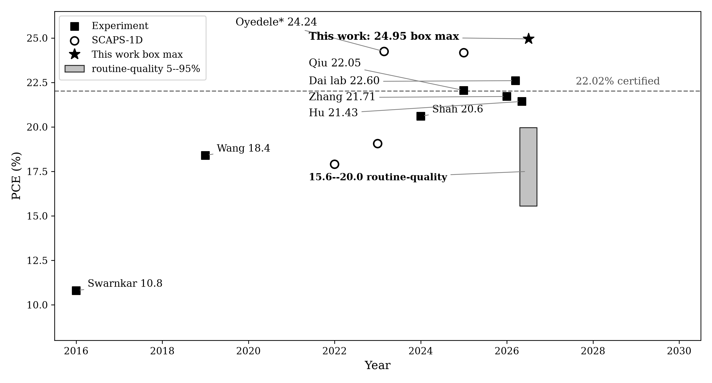
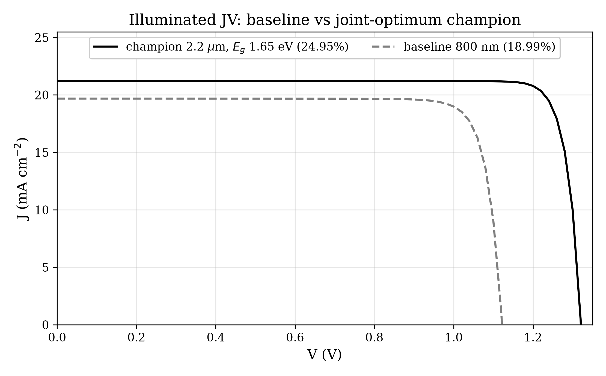
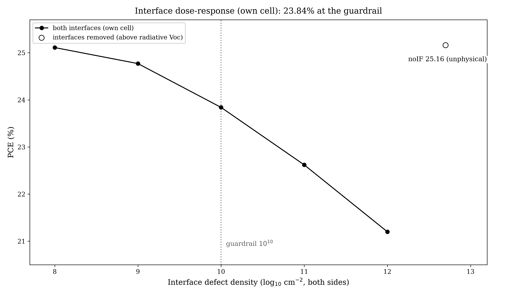
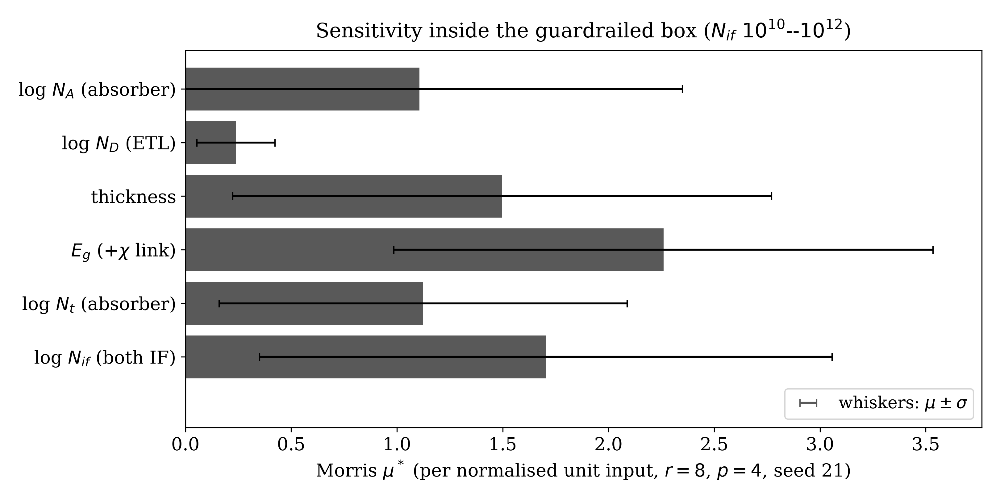
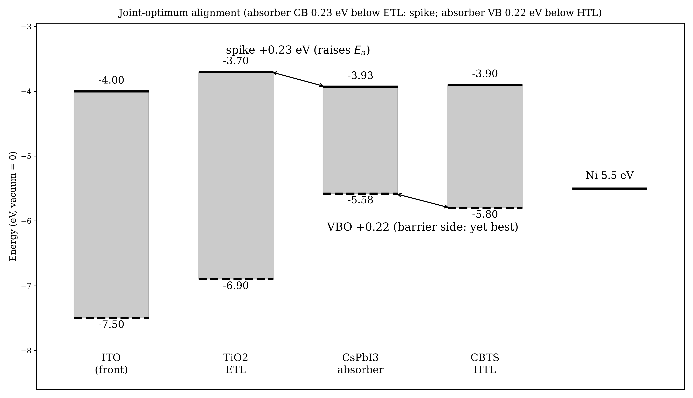

# Guardrails for the Record Race: What a CsPbI₃ Cell Can Honestly Claim (24.9% → 20.8%)

SCAPS-1D screening of an ITO/TiO₂/CsPbI₃/CBTS/Ni cell: best evaluated
guardrailed point (**24.95%**), surveyed-affinity best (23.50%), defended
routine-defect result (**20.82%**, 20.42% at R_s=1 Ω·cm²), interface
dose–response, scripted parasitics, and Morris sensitivity — with a
reproducibility audit of published 24%+ claims.

**Manuscript:** [`manuscript/document.tex`](manuscript/document.tex) →
[`drafts/draft-jbss-r7.pdf`](drafts/draft-jbss-r7.pdf) (r7 current)

Headline hierarchy (see manuscript abstract): 24.95% is the box maximum
(upper bound, not forecast); 20.82% is the number we would defend.

## Record race: experiment vs simulation



Black squares are certified/laboratory experiments; open circles are SCAPS-1D.
Every recent experimental jump came from defect and interface control — the
exact levers this study treats honestly, with interfaces switched on.

## Champion device (joint-affinity optimum, guardrailed interfaces)

2.2 µm absorber, N_A 3×10¹⁶ cm⁻³, N_t 10¹² cm⁻³ (single-crystal grade),
E_g 1.65 eV, χ_CBTS 3.9 / χ_TiO₂ 3.7 eV (joint optimum, both outside
surveyed/typical ranges), R_s = 0, 10¹⁰ cm⁻² interface defects on both
heterojunctions:



| | V_oc (V) | J_sc (mA/cm²) | FF (%) | PCE (%) |
|---|---|---|---|---|
| This work, joint optimum (SCAPS, R_s=0) | 1.321 | 21.20 | 89.11 | **24.95** |
| This work, surveyed affinities (SCAPS, R_s=0) | 1.234 | 21.19 | 89.78 | 23.50 |
| This work, routine defects (N_t 10¹⁵, 1.0 µm) | — | — | — | **20.82** (20.42 at R_s=1) |
| Dai et al. 2026 (lab / cert) | — | — | 86.1 | 22.60 / 22.02 |
| Baseline repro (Hossain 2023) | 1.122 | 19.68 | 86.00 | 18.99 |

Stated plainly: the optimum sits at the **edge of the allowed box** in
thickness and doping and on aggressive affinities, so 24.95% is an upper
bound; the best grid point at the literature gap (1.694 eV) reaches only
22.51% — roughly one point comes from the gap choice alone.

## Interface dose–response (own cell only, prior adopted base)



| N_if (cm⁻²) | PCE (%) |
|---|---|
| 10⁸ | 25.11 |
| 10⁹ | 24.77 |
| 10¹⁰ (guardrail) | 23.84 |
| 10¹¹ | 22.62 |
| 10¹² | 21.20 |
| 10¹² ETL side only | 21.35 |
| 10¹² HTL side only | 21.20 |
| removed (noIF) | 25.16 |

Audit pairs (same cell ± interfaces): 23.40→24.87 / 23.47→24.73 /
23.50→25.16 (+1.3–1.7 pts absolute, ≈+0.13 V V_oc). Joint-base check
(s22): 24.95% at 10¹⁰ → 24.24% at 10¹¹. The no-interface V_oc values
(1.363–1.382 V) hug the model-derived detailed-balance limit (1.371 V at
1.65 eV) with no margin — none is trusted. Published 24.17% / 24.24%
values are **not** placed on our curve: stacks, gaps and defect parameters
differ and neither paper prints a complete parameter table. Verification
bonus: σ×10 at fixed N reproduces the N×10 row exactly (22.21%),
confirming rate ∝ Nσ.

## Sensitivity: interfaces lead at the defect floor, bulk at routine levels



Morris screen (r=8 trajectories, p=4 levels, 56/56 converged):

| Factor | Range | μ* | per decade |
|---|---|---|---|
| log N_if (both interfaces) | 10⁸–10¹² cm⁻² | 4.08 | **1.02** |
| log N_t (absorber) | 10¹²–10¹⁵ cm⁻³ | 2.05 | 0.68 |
| E_g (+χ link) | 1.65–1.75 eV | 1.75 | 17.5/eV |
| thickness | 0.4–2.2 µm | 1.29 | 0.72/µm |
| log N_D (ETL) | 10¹⁶–10¹⁹ cm⁻³ | 0.68 | 0.23 |
| log N_A (absorber) | 10¹⁵–3×10¹⁶ cm⁻³ | 0.48 | 0.32 |

Paired-trajectory test: |EE_Nif|−|EE_Nt| = +2.03 pts (95% CI
[0.70, 3.51]) — interfaces genuinely lead **within the defect-floor
regime**. At routine defects (N_t 10¹⁵) the interface dose–response goes
nearly flat, so bulk defects dominate there. Large σ throughout = strong
interactions; E_g confounds gap with band offset via the χ link.

## Band alignment (activation-energy reading)



At the joint optimum the absorber conduction edge (−3.928 eV) lies 0.23 eV
**below** the TiO₂ edge (electron spike), and the absorber valence edge
(−5.578 eV) lies 0.22 eV **above** the CBTS edge (barrier-side hole
offset) — yet efficiency peaks there. Transport reasoning cannot produce
this; interface-activation energy can: E_a rises 1.47 → 1.87 eV across the
χ_CBTS sweep while efficiency climbs 22.10% → 24.95% at χ_TiO₂ 3.7.
Both optimum affinities are priced adoptions, not surveyed values.

## Priced assumptions (computed scripted sweeps, not analytic)

| Test | Result |
|---|---|
| R_s = 0.5 / 1 / 2 Ω·cm² (joint base) | 24.73% / **24.52%** / 24.09% |
| R_s = 3 / 4 / 5 Ω·cm² (joint base; routine base in brackets) | 23.66 / 23.23 / 22.80% (19.62 / 19.22 / 18.83%) — receipts `outputs/s36_rs.json` |
| R_s = 1 + R_sh = 10⁴ Ω·cm² combined | 24.38% |
| Ni 5.5 → 5.2 eV (surveyed χ) | no cost (digit-identical) |
| Ni 5.5 → 5.0 eV (surveyed χ) | −0.25 pts |
| Ni 5.0 eV at joint affinities | collapse to 15.63% (barrier cliff) |
| ITO 4.0 → 4.7 eV | collapse to 18.60% |
| ITO 4.4 eV at routine defects | −0.04 pts (surveyed χ) / −2.61 pts (adopted χ) |
| σ×10 at N_t floor | −0.25 pts (23.50 → 23.26%) |
| Routine defects (N_t 10¹⁵), best thickness | 20.82% @1.0 µm |
| Routine + R_s = 1 Ω·cm² | **20.42%** |

Also disclosed: τ_SRH ≈ 100 µs implied at the defect floor (1–2 orders
beyond best reported films; scales as 1/σ); k_rad = 0 in the model (no
radiative-limit claims beyond the model-derived V_oc screen at 1.371 V);
C–V 1/C² branch is linear and recovers the input doping (N_A = 2.93×10¹⁶,
V_bi = 1.30 V — solver self-consistency, not independent validation);
QE integral gives 22.39 vs IV 21.20 mA/cm² (gap carried as J_sc
uncertainty, IV value headlined); T-sweep 25.88% (275 K) → 18.13%
(475 K, solver stress test).

## Repository map

| Path | Contents |
|---|---|
| `manuscript/` | paper source (`document.tex`, `references.bib`, `figs/` portable copies) |
| `drafts/` | submission snapshots r0–r7 (r7 current, + `.docx`) |
| `defs/` | `csPbI3-CBTS-champion24p95.def` (+`.scaps` supervisor copy), `r7` surveyed base, `noIF`, WF/σ variants + builders |
| `outputs/` | all sweep data: `roundA/B.jsonl` (grid), `char.jsonl` (IV/T/audit/CV/QE/EB), `s1` dose+parasitics, `s5_morris.jsonl`, `s11` joint-χ, `s22` joint-IF check, `figs/` |
| `receipts/` | champion + baseline receipts |
| `scripts/` | runners (`roundA/B`, `s1_dose`, `s5_morris`, `s6_rev2`, `s11_joint_chi`, `s22_jointIF`, `fig_rev1`, `fig_timeline_v4`); `archive/` holds superseded one-offs |
| `review/` | JBSS format excerpts + r0 screenshots |
| `sources/` | reference PDFs (**not tracked** — copyrighted; see REFERENCES.md) |

## Reproduce

Requires SCAPS-1D 3.3.10 under WINE + `scaps-runner` (4 workers):

```bash
python3 scripts/s11_joint_chi.py  # joint-affinity map → 24.95% optimum
python3 scripts/s22_jointIF.py    # joint-base interface check (24.95 → 24.24)
python3 scripts/s1_dose.py        # interface dose + Rs/Rsh + WF grids
python3 scripts/s5_morris.py      # Morris screen (r=8, p=4, seed 7)
python3 scripts/fig_rev1.py       # alignment / audit / Morris figures
cd manuscript && pdflatex document.tex && bibtex document \
  && pdflatex document.tex && pdflatex document.tex
```

Supervisor 60-second demo: load `defs/champion24p95.scaps` in SCAPS-1D,
single shot → η ≈ 24.94% (see `SHOW_YOUR_SUPERVISOR.md`; 0.002-pt
file-vs-script path gap, inside the 0.017-pt IV-step threshold).

## Authors

Hussain Touhid Siddiquee (touhidsiddiqueeraj@gmail.com) ·
Md. Abdul Malek Fahim (mdabdulmalekfahim@gmail.com) —
Department of EEE, Leading University, Sylhet, Bangladesh.
